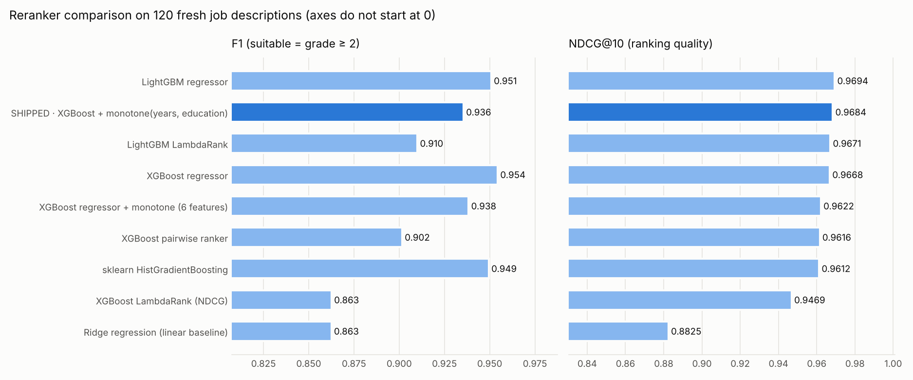

# Reranker model comparison — 8 models + the shipped file

Generated by `python -m docint.rank.compare_models` (from `ml/`). Raw numbers: `model_comparison.json`.
Earlier NDCG-only study with feature / training-data variants: `MODEL_STUDY.md`.

## What is measured

The reranker scores each (job description, retrieved candidate) pair; the recruiter sees the ranked list.

* **Classification view** — is the candidate *suitable* (relevance grade ≥ 2 of 3, rubric in `../LABELS.md`)?
  A pair counts as predicted-suitable when the model's score ≥ its threshold. The threshold is chosen per model on
  **out-of-fold training predictions** (max F1), never on test data. Computed over every candidate in each JD's top-50
  pool (6000 pairs on the fresh set, 3107 suitable).
  * **Accuracy** = correct suitable/unsuitable calls ÷ all pairs (inflated when most pairs are unsuitable)
  * **Precision** = of the candidates flagged suitable, how many really are · **Recall** = of the suitable
    candidates, how many were flagged · **F1** = harmonic mean of the two · **ROC-AUC** = threshold-free
    probability that a random suitable candidate scores above a random unsuitable one
* **Ranking view** (what the recruiter actually sees, threshold-free) — **NDCG@10** (graded quality of the top 10,
  the primary selection metric), **MRR** (how high the first suitable candidate is), **P@10** (share of the top 10
  that is suitable), **R@10** (share of the pool's suitable candidates that made the top 10).

Protocol: every model is trained on the same 18 train JDs with the same features as the shipped model (so only the
model differs), hyper-parameters chosen by inner GroupKFold on train JDs, then evaluated once on the 6 held-out test
JDs and on **120 fresh JDs** (new generator seed, never used for anything), over the serving-like corpus (resumes
rendered to PDF and parsed by the real ingestion pipeline).

## 1. Results on 120 fresh JDs (the decisive set)

| Model | Accuracy | Precision | Recall | F1 | ROC-AUC | NDCG@10 | MRR | P@10 | R@10 |
|---|---|---|---|---|---|---|---|---|---|
| LightGBM regressor | 0.948 | 0.937 | 0.966 | 0.951 | 0.981 | 0.9694 | 1.000 | 0.977 | 0.417 |
| **SHIPPED: XGBoost + monotone(years, education)** | 0.930 | 0.898 | 0.976 | 0.936 | 0.976 | 0.9684 | 0.996 | 0.974 | 0.415 |
| LightGBM LambdaRank | 0.901 | 0.859 | 0.967 | 0.910 | 0.965 | 0.9671 | 0.996 | 0.976 | 0.415 |
| XGBoost regressor | 0.952 | 0.933 | 0.977 | 0.954 | 0.981 | 0.9668 | 1.000 | 0.976 | 0.416 |
| XGBoost regressor + monotone (6 features) | 0.932 | 0.888 | 0.994 | 0.938 | 0.977 | 0.9622 | 1.000 | 0.967 | 0.411 |
| XGBoost pairwise ranker | 0.889 | 0.832 | 0.984 | 0.902 | 0.955 | 0.9616 | 1.000 | 0.973 | 0.413 |
| sklearn HistGradientBoosting | 0.947 | 0.940 | 0.959 | 0.949 | 0.980 | 0.9612 | 0.996 | 0.970 | 0.413 |
| XGBoost LambdaRank (NDCG) | 0.845 | 0.795 | 0.943 | 0.863 | 0.921 | 0.9469 | 0.996 | 0.942 | 0.395 |
| Ridge regression (linear baseline) | 0.858 | 0.862 | 0.863 | 0.863 | 0.932 | 0.8825 | 0.953 | 0.927 | 0.387 |

## 2. Results on the 6 held-out test JDs (small — for completeness)

| Model | Accuracy | Precision | Recall | F1 | ROC-AUC | NDCG@10 | MRR | P@10 | R@10 |
|---|---|---|---|---|---|---|---|---|---|
| LightGBM regressor | 0.920 | 0.900 | 0.900 | 0.900 | 0.966 | 1.0000 | 1.000 | 1.000 | 0.541 |
| **SHIPPED: XGBoost + monotone(years, education)** | 0.877 | 0.799 | 0.925 | 0.857 | 0.952 | 0.9629 | 1.000 | 0.967 | 0.527 |
| LightGBM LambdaRank | 0.843 | 0.730 | 0.967 | 0.832 | 0.953 | 0.9412 | 1.000 | 0.950 | 0.502 |
| XGBoost regressor | 0.917 | 0.893 | 0.900 | 0.896 | 0.969 | 0.9785 | 1.000 | 1.000 | 0.541 |
| XGBoost regressor + monotone (6 features) | 0.883 | 0.793 | 0.958 | 0.868 | 0.972 | 0.9692 | 1.000 | 0.983 | 0.532 |
| XGBoost pairwise ranker | 0.820 | 0.699 | 0.967 | 0.811 | 0.937 | 0.9400 | 1.000 | 0.917 | 0.481 |
| sklearn HistGradientBoosting | 0.910 | 0.904 | 0.867 | 0.885 | 0.964 | 0.9860 | 1.000 | 1.000 | 0.541 |
| XGBoost LambdaRank (NDCG) | 0.760 | 0.633 | 0.950 | 0.760 | 0.898 | 0.9121 | 1.000 | 0.867 | 0.451 |
| Ridge regression (linear baseline) | 0.840 | 0.728 | 0.958 | 0.827 | 0.954 | 0.8906 | 1.000 | 0.917 | 0.474 |

## 3. Paired differences vs the shipped model (fresh JDs, bootstrap 95% CI)

A difference whose CI includes 0 is **not** a real difference.

| Model | NDCG@10 diff [95% CI] | per-JD F1 diff [95% CI] | NDCG wins/losses |
|---|---|---|---|
| LightGBM regressor | +0.0010 [-0.0043, +0.0062] | +0.021 [+0.012, +0.031] | 20/24 |
| LightGBM LambdaRank | -0.0013 [-0.0073, +0.0047] | -0.029 [-0.038, -0.020] | 20/24 |
| XGBoost regressor | -0.0016 [-0.0064, +0.0032] | +0.024 [+0.015, +0.034] | 19/22 |
| XGBoost regressor + monotone (6 features) | -0.0062 [-0.0127, -0.0000] | +0.003 [-0.002, +0.008] | 19/32 |
| XGBoost pairwise ranker | -0.0068 [-0.0139, +0.0001] | -0.037 [-0.047, -0.027] | 19/35 |
| sklearn HistGradientBoosting | -0.0071 [-0.0134, -0.0012] | +0.018 [+0.009, +0.028] | 17/38 |
| XGBoost LambdaRank (NDCG) | -0.0215 [-0.0315, -0.0121] | -0.078 [-0.090, -0.066] | 19/52 |
| Ridge regression (linear baseline) | -0.0859 [-0.1049, -0.0663] | -0.079 [-0.099, -0.061] | 11/84 |

## 4. Why XGBoost (the shipped model) was chosen

**Short answer:** for *ranking* — the job the reranker does in the app — the shipped XGBoost is statistically tied with the best of the 8 alternatives and significantly better than 4 of them; none beats it. On the *yes/no suitable* view (F1) the unconstrained boosted regressors are ~0.02 higher; that small cost comes from the fairness constraint and was accepted deliberately. XGBoost vs LightGBM is a tie, so the simpler, already-integrated XGBoost stays.

1. **Ranking (primary metric, NDCG@10): tie with the best.** Shipped 0.9684. Not significantly different: XGBoost regressor -0.0016 [-0.0064, +0.0032], XGBoost pairwise ranker -0.0068 [-0.0139, +0.0001], LightGBM LambdaRank -0.0013 [-0.0073, +0.0047], LightGBM regressor +0.0010 [-0.0043, +0.0062]. Significantly worse: XGBoost regressor + monotone (6 features), XGBoost LambdaRank (NDCG), sklearn HistGradientBoosting, Ridge regression (linear baseline). No model is significantly better.
2. **Classification (F1, suitable = grade ≥ 2): the shipped model gives up ~0.02.** Shipped F1 0.936 (precision 0.898, recall 0.976); significantly higher per-JD F1: XGBoost regressor +0.024 [+0.015, +0.034], LightGBM regressor +0.021 [+0.012, +0.031], sklearn HistGradientBoosting +0.018 [+0.009, +0.028]. The cause is the monotone constraint, not the library: the same XGBoost without constraints scores F1 0.954, with monotone constraints 0.938 (shipped 0.936). We keep the constraint because (a) the app never makes a yes/no cut — it ranks, and `match_score` is shown as a relative score, so F1 at a threshold is not what users experience; and (b) it guarantees that more experience or a higher degree can never *lower* a candidate's score (it fixed a real case where PhDs were ranked below Master's). If the product later adds a "suitable / not suitable" flag, use the unconstrained XGBoost regressor with a threshold tuned on validation JDs.
3. **Why XGBoost and not LightGBM?** They are statistically tied: LightGBM regressor NDCG@10 0.9694 vs XGBoost 0.9668 / shipped 0.9684, F1 0.951 vs 0.954. In the earlier cross-validation screen LightGBM led by ~0.009 NDCG, but the lead did not replicate on fresh JDs (`MODEL_STUDY.md`). With no measurable gain, switching would add a dependency, a new model format and re-validation of train/serve parity for nothing.
4. **Learning-to-rank objectives (LambdaRank, pairwise) bring nothing:** at best tied on NDCG@10 and significantly worse on F1 / ROC-AUC (their scores are not on a label scale, so a cut-off generalises poorly). With ~50 candidates per JD and 4 grades, regressing the graded label is the more stable choice.
5. **A non-linear model is required.** Ridge (linear) reaches only F1 0.863 / NDCG@10 0.8825: skill coverage, years gap and education gap act as thresholds that interact, which boosted trees capture and a straight line cannot.
6. **Robust to the embedder change** (stand-in vectors at training, BGE at serving): under an embedder shift the shipped model lost significantly less NDCG than Ekant's original v1.1 model (+0.0075, 95% CI [+0.0015, +0.0134], `MODEL_STUDY.md` §2).
7. **Engineering fit:** one small JSON model file, 1.38 ms to score the 50 candidates of a search, output on the 0–100 scale the UI shows, train/serve parity tests already in place, and documented by Track C (Ekant).

## 5. Caveats

* Labels are synthetic and partly circular: the rubric uses skill coverage, years and education, which are also the
  strongest features, so every tree model scores very high. Compare rows; do not quote absolute numbers as real-world
  accuracy.
* About 52% of the pooled pairs are suitable, so accuracy is meaningful here, but F1, ROC-AUC and NDCG are
  still the more informative columns. Thresholds were tuned for F1; a different cut-off trades precision for recall.
* R@10 looks low for every model because a JD has ~26 suitable candidates in its pool and the top 10 can hold only
  10 of them (maximum ≈ 0.4); compare it between rows only.
* Embeddings in this environment are a deterministic stand-in; `MODEL_STUDY.md` shows the choice also holds when the
  embedder changes between training and serving.
